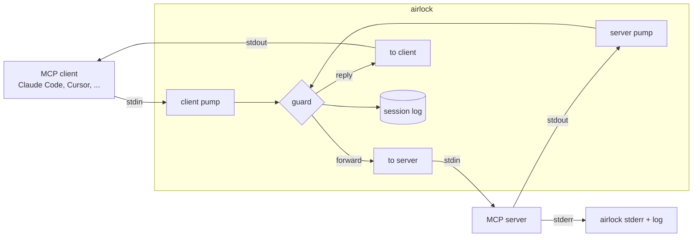

# How airlock works

airlock is one process with two pumps and a decision function between them.



## The pipe

The MCP stdio transport is newline-delimited JSON-RPC: one message per line, no embedded newlines. airlock starts the server with pipes on stdin, stdout and stderr and runs two pumps.

- The **client pump** reads lines from airlock's stdin, hands each to the guard, and writes what the guard says to forward into the server's stdin. Replies the guard writes itself (a blocked call's answer) go back out on airlock's stdout.
- The **server pump** does the same in the other direction.
- Both pumps can write to the same stream (the client pump writes blocked-call replies to the client while the server pump forwards responses), so each output stream has a mutex and frames are written whole.

A frame that is forwarded unchanged is forwarded byte for byte. Only the line terminator is normalised: a server that writes `\r\n` reaches the client with `\n`.

When the client closes airlock's stdin, airlock closes the server's stdin, which is how MCP asks a stdio server to exit. airlock exits when the server does, with the server's status, or 128+N if signal N killed it.

Process lifetime differs by platform:

- **Linux and macOS.** The server runs in its own process group, and SIGINT, SIGTERM, SIGHUP and SIGQUIT sent to airlock are forwarded once. Linux also sets `Pdeathsig`, so the server gets SIGTERM if airlock is killed outright.
- **Windows.** There are no signals to forward, and Node's `child.kill()` is `TerminateProcess`: airlock gets no chance to clean up. The server is therefore put in a job object with `JOB_OBJECT_LIMIT_KILL_ON_JOB_CLOSE`. airlock holds the only handle, so when airlock dies the server dies too, along with whatever it spawned (`npx` → `node` → the server).

## The guard

The guard parses each frame (`internal/jsonrpc`) and keeps a little state:

- a map from client request id to the method and tool name, so a response can be matched to what it answers;
- the protocol version, from `initialize` or from the `io.modelcontextprotocol/protocolVersion` key that 2026-07-28 puts in every request's `_meta`;
- the tool definitions the client was last shown, and the set of tools that are blocked.

Request ids keep their JSON spelling as map keys, so `1` and `"1"` stay different ids, as JSON-RPC requires.

Client messages go through these checks, in order:

1. **Malformed frames** (with a policy). A message with a repeated member is refused. With `default = "deny"`, a frame that isn't JSON-RPC at all is dropped. See [Duplicate members](#duplicate-members).
2. **`tools/call` checks**, in the order below.

| Step | Check | Refused with |
|---|---|---|
| 1 | Pinning: the tool is blocked because its definition drifted, it is new, or it looks poisoned | `by: pinning` |
| 2 | The tool was never listed, and isn't in the lockfile either (`unknown_tools = "deny"`) | `by: unknown-tool` |
| 3 | Policy rules: the first rule whose `tools` globs match decides, else the default | `by: rule`, `by: default` |
| 4 | That rule's argument constraints | `by: args` |
| 5 | The tool's own `inputSchema` | `by: schema` |
| 6 | The rule's rate limit | `by: rate` |

The rate limit is checked last so that a call refused for another reason does not spend a token.

A refused call never reaches the server. airlock answers it with a `CallToolResult` whose `isError` is true and whose text gives the reason. It does not use a JSON-RPC error, because the spec routes tool-level failures through the result: the model sees why the call failed and can try something else. For 2026-07-28 sessions the result also carries `resultType: "complete"`, which that revision requires on every result.

Batches (allowed before 2025-06-18) are taken apart. Each member is checked as if it had arrived alone, the members that pass are forwarded as a smaller batch, and the refusals go back as a batch. Otherwise a batch would be a way to slip a call past the checks.

Server messages are matched to their requests. `tools/list` results go through [pinning](#pinning). Results of `tools/call`, `resources/read` and `prompts/get` go through [redaction](#redaction).

## Pinning

Each tool in a `tools/list` result is reduced to a canonical form:

- keys sorted at every level;
- numbers kept as written;
- no HTML escaping;
- the top-level `_meta` dropped, because it is meant for out-of-band data that may change on every listing.

The hash is SHA-256 over that form. Everything else is included: name, title, description, both schemas, annotations, icons, and any field a later revision adds. A server upgrade that adds a field therefore counts as a change. That is intended: you approved one definition, and this is another.

Pins live in memory for the session, or in a lockfile:

```json
{
  "//": "airlock tool pins: ...",
  "version": 1,
  "tools": {
    "get_forecast": {
      "sha256": "87785f4ba2c86f0d...",
      "pinned_at": "2026-11-25T02:47:32Z",
      "definition": { "name": "get_forecast", "description": "Get the weather forecast for a city.", "...": "..." }
    }
  }
}
```

The full definition is kept so a drift event can show a diff. The lockfile is written to a temporary file and renamed into place, so a crash never leaves half a lockfile.

For each listed tool:

| State | What airlock does |
|---|---|
| Same hash as its pin | Allow it. If it had been blocked, the block lifts: the server went back to what was approved. |
| No pin, and no lockfile with pins | Pin it. This is trust on first use. |
| No pin, but the lockfile has others | A new tool. Follow `on_new_tool`: allow, warn, or block. |
| Different hash | Drift. Log both definitions and follow `on_drift`. Under `block`, the tool is removed from the list the client receives and calls to it are refused. |

A complete listing (no cursor in the request, no `nextCursor` in the result) that lacks a tool the client was shown earlier produces a `removed` event.

`--repin` accepts whatever the server lists now as the new pins.

### Heuristics

Every string in a definition is scanned: description, title, and the descriptions inside the schemas. Matches are labelled heuristics in the log and the viewer.

| Rule | Severity | Looks for |
|---|---|---|
| `hidden-tag-characters` | high | U+E0000 to U+E007F. These render as nothing but map one-to-one onto ASCII. The flag includes the decoded hidden text. |
| `invisible-characters` | high | Zero-width characters, bidi embeddings, overrides and isolates, word joiners, BOM, soft hyphen |
| `instruction-tag` | high | `<IMPORTANT>`, `<system>`, `<instructions>`, `<secret>`, `<hidden>`, `<admin>` |
| `conceal-or-override` | high | "ignore previous instructions", "do not tell the user", "without informing the user", ... |
| `sensitive-path` | low, or high inside hidden text | `~/.ssh`, `id_rsa`, `.aws/credentials`, `.env`, `mcp.json`, `claude_desktop_config`, ... |
| `mentions-other-tool` | low | The description names another tool on the same server |
| `long-description` | low | More than 4000 characters |

`on_suspicious` acts on high-severity flags only. The low ones are notes. `mentions-other-tool` fires on server-filesystem's own `read_file` ("DEPRECATED: Use read_text_file instead"), which is why it is low.

These catch the published tool-poisoning examples and obvious variations of them. A careful attacker writes a description that reads like documentation and asks for something plausible. No pattern list catches that, and pinning is the defence that does not depend on wording.

## Policies

A policy is TOML. TOML was chosen over YAML because:

- a policy is security configuration, and YAML's implicit typing (`no` becomes false, `012` is octal in YAML 1.1) is the wrong kind of surprise there;
- `[[rule]]` array tables read naturally as an ordered rule list;
- comments are allowed, unlike JSON.

Unknown keys are an error. `defualt = "deny"` fails to load instead of silently meaning "allow".

Rules are evaluated top to bottom, and the first rule whose tools match decides, as in a firewall. A deny rule refuses. An allow rule then applies its argument constraints, and if one fails the call is refused: a later rule never rescues a call an earlier rule matched. Tool globs support `*` and `?` and nothing else, so tool names with dots or brackets need no escaping.

Argument constraints apply to string arguments, and to every element of an array of strings:

| Constraint | Meaning |
|---|---|
| `prefix` | The path, once cleaned, must equal one of the prefixes or lie inside it. Matching is by path segment, so `/work` does not cover `/workshop`. `C:\a\..\b` and `C:/b` compare equal. Drive-letter paths compare case-insensitively. Relative paths and `~` are refused, because airlock cannot know what the server will resolve them against. |
| `regex`, `not_regex` | Go RE2 syntax, unanchored (write `^...$` to anchor) |
| `max_length` | In bytes |

What a path constraint cannot see is the filesystem: a symlink inside an allowed directory that points outside it passes. Only the server can check that, and server-filesystem does.

Rate limits are token buckets per rule and tool: `"20/min"` allows a burst of 20, then refills at 20 per minute.

## Schema validation

With `[schema] validate = true` (the default when a policy is loaded), `tools/call` arguments are validated against the tool's `inputSchema`. The rules follow the 2026-07-28 spec:

- JSON Schema 2020-12 unless `$schema` names an earlier draft. Draft-07 schemas, which many servers still emit, work.
- `$ref` within the schema resolves. External refs are refused, both network URIs (the spec says MUST NOT) and `file://` URIs. The validation library's default loader reads local files, so without this a tool schema could make airlock open files on its behalf.
- Bounds against schemas built to burn CPU: 256 KiB, nesting depth 32, 2000 objects.

A schema that cannot be compiled means calls to that tool are refused. The spec says such schemas SHOULD be rejected rather than treated as permissive.

The error the model sees is short and uses JSON pointers: `arguments do not match the tool's inputSchema: /: missing property 'edits'`.

If the client calls a tool it never listed in this session (2026-07-28 lets clients cache `tools/list`), the lockfile's pinned definition is used for validation.

## Redaction

Results of `tools/call`, `resources/read` and `prompts/get` are scanned before the client sees them. Every string in the result is checked, including `structuredContent`, and matches become `[redacted:<pattern name>]`. The log stores the redacted version, so secrets do not end up there either.

The fast path decides whether a frame needs a full walk without decoding it. Each built-in pattern has hints: literal substrings every match contains (`AKIA`, `ghp_`, `sk-ant-`, `PRIVATE KEY-----`, ...). Each hint is looked up by its rarest byte with one vectorised `IndexByte` pass per distinct anchor byte. Only a frame that contains a hint, or any `\u` escape (which could spell a hint in disguise), gets decoded and walked. Custom patterns can declare `hints` too; without them, they are matched against the raw bytes, and any backslash escape forces the walk.

Go's `regexp` is RE2, so matching time is linear in the input and a pattern cannot be turned into a denial of service by a large result.

## Duplicate members

`{"name":"read_file","name":"write_file"}` is valid JSON with no agreed meaning:

- Go's `encoding/json` keeps the last value.
- Some parsers keep the first, and some refuse the object.
- Go also matches struct fields regardless of case, so `{"name":"read_file","NAME":"write_file"}` means `write_file` to a Go struct and `read_file` to JavaScript.

A proxy that reads a message one way while the server behind it reads it another way can be steered around. airlock therefore refuses any client message where an object repeats a member, comparing names case-insensitively, with JSON-RPC error -32600. Legitimate MCP traffic does not do this.

## The log

A session log is JSON Lines. A record:

```json
{"seq":7,"ts":"2026-11-25T02:47:32.481Z","kind":"msg","dir":"c2s","msg":{...},"prev":"5b0e...","hash":"9c1d..."}
```

| `kind` | Meaning |
|---|---|
| `open` | Session header: airlock version, server command, working directory, pid, policy path and SHA-256, lockfile, signing key |
| `msg` | A frame. `dir` is `c2s` and `s2c` for forwarded frames, `c2a` for a client frame airlock stopped, and `a2c` for airlock's own reply. A frame that isn't JSON is stored as `msg_text`. |
| `event` | A decision: `allow`, `deny`, `redact`, `pin`, `drift`, `new_tool`, `suspicious`, `removed`, `repin`, `protocol`, `malformed` |
| `stderr` | One line of server stderr |
| `checkpoint` | A signature over the chain so far |
| `close` | Exit status and record count, signed when a key is in use |

`hash` is the SHA-256 of the record's own line with the `,"hash":"..."` member removed. Since `hash` is always the last member and fixed-width, verification is a string operation: no JSON canonicalisation, nothing to disagree about between the Go verifier and the browser one. `prev` is the hash of the record before, and `seq` counts from 0, so changing, inserting, removing or reordering a record breaks the chain at that point.

What the chain does not do on its own is stop someone who can rewrite the whole file: they can recompute every hash. `TestUnsignedRewriteIsUndetectable` keeps that limitation on record. Two things help:

- **Signing.** `airlock keygen` makes an Ed25519 key, and with `--sign-key` airlock writes a `checkpoint` record every N records (256 by default). The checkpoint carries a signature over `"airlock checkpoint v1\n" + seq + "\n" + prev`, and the closing record is signed the same way. A rewrite now needs the private key, so keep it somewhere the agent cannot read.
- **Anchoring the head.** On exit airlock prints the final hash to stderr. `airlock verify --head <hash>` checks a log against it, which catches records removed from the end even in an unsigned log.

Truncation is the honest limit. A log without a closing record reads the same whether airlock was killed or the end was cut off, and `verify` says exactly that. With signing, everything up to the last valid signature is proven; what comes after is covered by the chain only.

## The viewer

`internal/viewer/static` is a dependency-free page: ES modules, no build step, embedded into the binary with `go:embed` and published unchanged to GitHub Pages.

- **`log.js`** parses records, verifies the chain with WebCrypto (and Ed25519 signatures where the browser supports them), and builds the timeline. It turns request and response pairs into one row and attaches events to the call they concern by JSON-RPC id. It runs under `node --test` too.
- **`app.js`** renders. Every string from a log goes into the page as a text node, never as HTML. Unicode tag characters are decoded and shown inline as "hidden: ...". A drifted tool gets a word diff of its description and a line diff of its definition.

`airlock view` serves the page on 127.0.0.1 under a random path token. It refuses requests whose `Host` header isn't its own address, which stops DNS rebinding. It also sends a CSP that allows nothing but its own origin.
